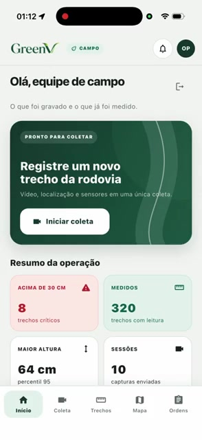
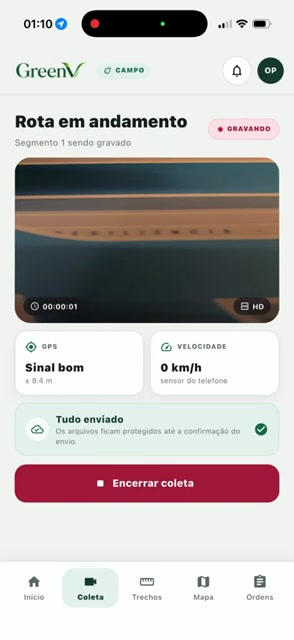
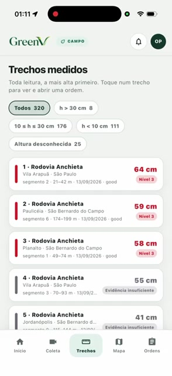
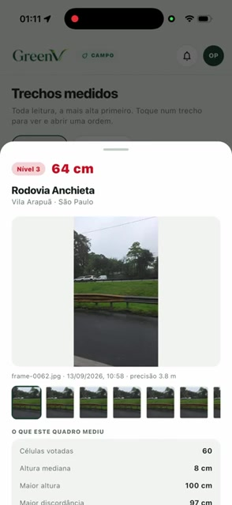
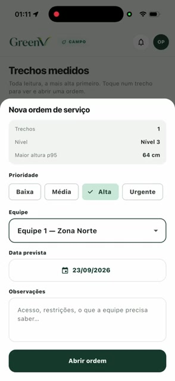
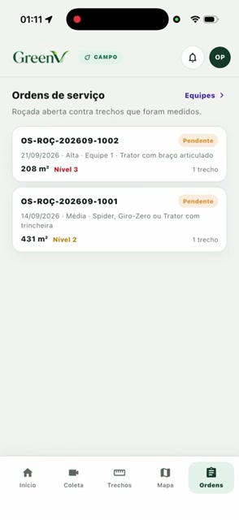
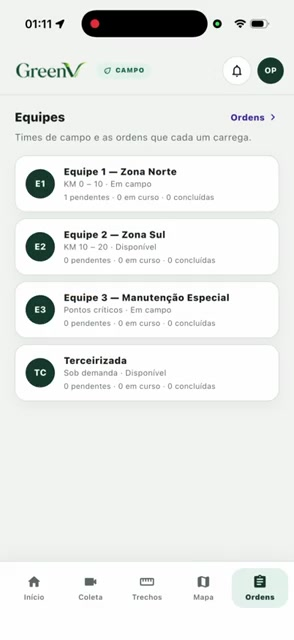
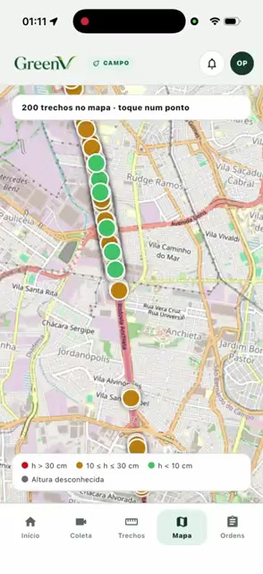
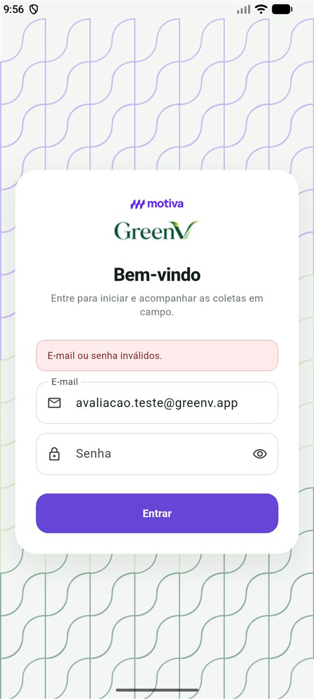
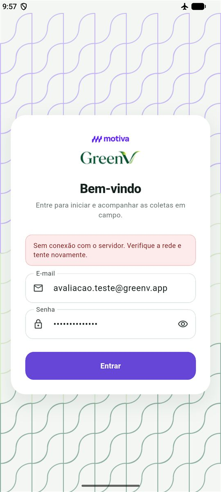

# GreenV — Versão final (Sprint 4)

Aplicativo móvel da Motiva para registrar rotas rodoviárias, enviar vídeo e telemetria para
processamento e acompanhar os trechos em que a vegetação da faixa de domínio exige roçada.

| | |
|---|---|
| 📦 **APK para instalar** | [GreenV-1.1.0.apk — GitHub Releases](https://github.com/Matomomitsu/sprint-cross-plataform/releases/download/v1.1.0/GreenV-1.1.0.apk) |
| ▶️ **Vídeo de pitch e demonstração** | [YouTube](https://youtube.com/shorts/irqRgWPfklU?feature=share) |
| 💼 **Plano de negócio** | [PLANO_DE_NEGOCIO.md](PLANO_DE_NEGOCIO.md) |
| ✅ **Documento de testes** | [TESTES_MANUAIS.md](TESTES_MANUAIS.md) |
| 🌐 **Painel web e API** | [greenv.matomomitsu.com](https://greenv.matomomitsu.com) · `https://greenvapi.matomomitsu.com` |
| 🗂️ **Repositório principal do challenge** | [henrikmm/GreenV](https://github.com/henrikmm/GreenV) |

## Integrantes

| Integrante | RM |
|---|---:|
| Helena Barbosa Costa | 562450 |
| Henrique Mandrick | 562715 |
| Mateus Scandiuzzi Valente Tomomitsu | 561565 |
| Ryan Amorim de Castro Santana | 564393 |
| Thomas Joh Kobayashi | 562758 |

## Proposta de solução

Hoje a concessionária decide onde mandar a equipe de roçada com pouca informação: alguém percorre
a rodovia, olha a margem e anota, ou a equipe segue um calendário fixo, haja ou não vegetação alta.
Em uma malha de 5.044 km isso significa pagar roçadas desnecessárias em alguns trechos e chegar
atrasado em outros, onde a vegetação já encobre placas, acostamentos e drenagem.

**O GreenV transforma uma passagem comum de veículo em uma decisão.** O celular, preso a um suporte
na viatura que já circula pela rodovia, grava vídeo em segmentos de 10 segundos com GPS e sensores.
A nuvem divide a rota em trechos de ~25 m, reconstrói cada trecho em 3D, mede a altura da vegetação
em centímetros e devolve uma lista ordenada do mais alto para o mais baixo, com o quadro de vídeo
que justifica cada leitura. O supervisor filtra, vê no mapa, abre a ordem de serviço no próprio
trecho e acompanha as equipes.

| Nível | Altura | Cor |
|---|---|---|
| Crítico | acima de 30 cm | 🔴 |
| Atenção | de 10 a 30 cm | 🟡 |
| Controlado | abaixo de 10 cm | 🟢 |
| Inconclusivo | vegetação vista, sem altura confiável | ⚪ |

## Instalação do APK

O APK é distribuído pelo **GitHub Releases**; binários não são versionados no repositório.

1. No celular Android (Android 7.0 ou superior), abra o link
   [GreenV-1.1.0.apk](https://github.com/Matomomitsu/sprint-cross-plataform/releases/download/v1.1.0/GreenV-1.1.0.apk)
   e baixe o arquivo.
2. Toque no arquivo baixado. Na primeira vez o Android pede para **permitir a instalação de apps
   desta fonte** (Configurações → Apps → Acesso especial → Instalar apps desconhecidos). Permita
   para o navegador ou o gerenciador de arquivos usado.
3. Toque em **Instalar**. O app aparece como **Motiva Coleta**.
4. Abra o app e entre com uma conta corporativa cadastrada na API.
5. Na primeira coleta, permita o acesso à **câmera** e à **localização**.

Pelo computador, com o celular conectado por USB e a depuração ativada:

```bash
adb install GreenV-1.1.0.apk
```

| Item | Valor |
|---|---|
| Versão | 1.1.0 (build 2) |
| Pacote | `br.com.greenv.greenv_capture` |
| Android mínimo | 7.0 (API 24) |
| API embutida | `https://greenvapi.matomomitsu.com` |
| SHA-256 | `d252eaeb407206189b40c2e39c5a139e4ca0265b15dc166564949a6ed694a391` |

O APK é assinado com a chave de depuração do Flutter, o que basta para instalação direta
(*sideload*). A publicação na Play Store exigiria uma chave de assinatura própria.

> A API desliga quando ninguém a usa. No primeiro acesso do dia ela leva de 10 a 25 segundos para
> subir, e o app mostra “Acordando o servidor…” com um contador enquanto isso.

## Stack utilizada

| Camada | Tecnologia |
|---|---|
| Aplicativo móvel (este repositório) | Flutter 3.47 e Dart 3.13 · `camera`, `geolocator`, `sensors_plus`, `flutter_map` + OpenStreetMap, `http`, `crypto` (SHA-256), `wakelock_plus` |
| API e controle | Spring Boot (Java 21) no Azure Container Apps, com escala até zero |
| Processamento | Extrator de quadros (Java + ffmpeg), worker de medição (Node 22), filas Azure Queue |
| Reconstrução 3D | Depth Anything 3 em GPU sob demanda (RunPod) |
| Dados e arquivos | Neon PostgreSQL · Cloudflare R2 |
| Painel web | React 18, Vite e Leaflet no Cloudflare Pages |
| Infraestrutura | Terraform |

A API, os workers, a medição e o painel ficam no [repositório principal](https://github.com/henrikmm/GreenV).
Este repositório contém o aplicativo móvel entregue na disciplina.

## Plano de negócio (resumo)

O documento completo, com fontes e premissas, está em [PLANO_DE_NEGOCIO.md](PLANO_DE_NEGOCIO.md).

- **Proposta de valor:** roçar menos onde não precisa, roçar antes onde é crítico e provar as duas
  coisas com foto, altura e data de cada trecho.
- **Personas:** supervisora de conservação (decide a semana de roçada), inspetor de tráfego (coleta
  sem digitar nada, na rota que já faz) e gerente de contrato (orçamento e indicadores da concessão).
- **Público-alvo:** a Motiva como cliente âncora (5.044 km), com piloto no Rodoanel Oeste
  (SP-021, km 0–29,3); depois outras concessionárias e prestadoras de roçada.
- **Modelo de receita:** piloto pago de 3 meses (R$ 45 mil) e assinatura por km de rodovia
  monitorado por mês (R$ 80, R$ 60 ou R$ 45, conforme o volume), com até 2 passagens por mês em
  cada sentido; passagens extras, kit de câmeras fixas e integração como serviços opcionais.
- **Custos:** processamento em GPU de ≈ US$ 0,62 (R$ 3,18) por km processado; custo variável de
  ≈ R$ 14 por km monitorado por mês; equipe enxuta de ≈ R$ 70 mil por mês. Na malha completa da
  Motiva: custo de ≈ R$ 156 mil e receita de R$ 227 mil por mês.
- **Impacto para a Motiva:** com um gasto estimado de R$ 36 milhões por ano em roçada (referência
  SICRO), evitar de 10% a 20% dos ciclos desnecessários vale de 1,3 a 2,7 vezes o custo da
  assinatura, além dos ganhos em segurança viária, evidência para a fiscalização e ESG.
- **Diferenciais:** captura com celular comum na viatura que já circula (contra veículo LiDAR,
  drone ou satélite), evidência auditável por trecho, funcionamento sem sinal e arquitetura modular.
- **Principais riscos:** licença comercial do modelo de profundidade, acurácia automática ainda não
  comparada com trena, falta de referência quilométrica e LGPD nos vídeos. Cada um tem mitigação
  no documento.

## Resumo das entregas por Sprint

| Sprint | Entrega | Destaques |
|---|---|---|
| **1** | Concepção e protótipo | Problema, persona, requisitos funcionais e não funcionais, níveis de classificação da vegetação e [protótipo no Figma](https://www.figma.com/design/lVJExT1IOtFD2HEJTX9F85/Challenge-Motiva?node-id=163-384&t=AWaV78ic9flHe7Vu-1) |
| **2** | Primeiras telas em React Native (Expo) | Splash, login, home, upload e mapa navegáveis, ainda com dados de apresentação |
| **3** | Migração para Flutter e integração real | App completo consumindo a API publicada: login corporativo, dashboard, coleta em segmentos com GPS e sensores, fila offline, trechos com frames, mapa, ordens de serviço e equipes; 71 testes automatizados; [demonstração em vídeo](https://youtube.com/shorts/irqRgWPfklU?feature=share) |
| **4** | Versão final, APK e plano de negócio | Correções apontadas na avaliação da Sprint 3, APK de release apontando para a API publicada, cenários de erro testados, correção do teclado no login e [plano de negócio](PLANO_DE_NEGOCIO.md) |

## Pendências da Sprint 3 e ajustes da Sprint 4

Pontos apontados na avaliação da Sprint 3 e o que foi feito em cada um:

| Ponto apontado | Ajuste feito na Sprint 4 | Status |
|---|---|:---:|
| O README não trazia as pendências e o plano de ajustes | Esta seção | ✅ |
| Os testes manuais registravam só caminhos de sucesso | 16 cenários de erro e usabilidade (sem rede, credencial inválida, serviço fora do ar, sessão expirada, listas vazias, ordem recusada, câmera negada, GPS impreciso, segundo plano, teclado), cada um com teste automatizado; login com senha errada e sem rede executados no APK. Ver [TESTES_MANUAIS.md](TESTES_MANUAIS.md) | ✅ |
| `operations_screens.dart` (~2.000 linhas) e `capture_app.dart` (~1.300 linhas) concentravam telas demais | Divididos em um arquivo por tela: `ui/auth/`, `ui/capture/` e `ui/operations/`. O maior arquivo de tela agora tem ~470 linhas, e `capture_app.dart` ficou só com a raiz do app e a navegação | ✅ |
| Histórico da Sprint 3 em dois commits de um único integrante | Explicação na seção [Participação do grupo](#participação-do-grupo) | ✅ |

Defeitos encontrados durante a Sprint 4 e corrigidos:

| Defeito | Correção |
|---|---|
| **Teclado preso no login:** tocar fora dos campos não fechava o teclado no celular, que ficava sobre o botão **Entrar** | Um toque em qualquer área que não seja um campo, ou arrastar a tela, fecha o teclado em todo o app |
| Sem rede, o dashboard e a tela de ordens geravam um erro não tratado por trás do cartão de erro | As duas requisições paralelas passaram a ser aguardadas juntas (`both()` em `remote_data.dart`) |
| Câmera negada exibia o texto técnico da exceção (`CameraException(...)`) | Mensagens em português que dizem ao operador o que fazer (`capture_error_message.dart`) |
| O APK gerado sem `--dart-define` apontava para o emulador (`10.0.2.2`) | Builds de release usam a API publicada por padrão |
| Botão “Notícias da operação” no login não fazia nada | Removido |

## Participação do grupo

Este repositório guarda apenas o aplicativo móvel no formato pedido pela disciplina. O projeto do
challenge Motiva é desenvolvido no **repositório principal, [henrikmm/GreenV](https://github.com/henrikmm/GreenV)**,
que reúne o app (`apps/mobile`), a API, os workers de processamento, a medição 3D (Verge Studio),
os painéis web e a infraestrutura.

O app Flutter foi construído lá, ao longo de dezenas de commits, e depois trazido para este
repositório de uma vez, já pronto. Por isso o histórico da Sprint 3 aqui aparece em dois commits
grandes de um único integrante: **a participação de cada integrante está registrada no
repositório principal**, onde o código foi de fato escrito e revisado.

| Integrante | Frente no projeto |
|---|---|
| Helena Barbosa Costa | Design e front-end; protótipo e telas das Sprints 1 e 2 (histórico deste repositório) |
| Henrique Mandrick | Reconstrução 3D e IA |
| Mateus Scandiuzzi Valente Tomomitsu | Visão computacional |
| Ryan Amorim de Castro Santana | Previsão de crescimento da vegetação |
| Thomas Joh Kobayashi | Front-end e proteção |

As alterações da Sprint 4 também foram levadas ao repositório principal, na branch
`feat/mobile-sprint4-final`.

## Migração para Flutter

O projeto das Sprints anteriores usava React Native com Expo. Na Sprint 3 o aplicativo foi migrado
integralmente para Flutter. A decisão começou pela familiaridade dos integrantes com Dart e com a
organização de projetos Flutter, o que permitiu dividir melhor as tarefas, revisar o código em
conjunto e resolver problemas mais rápido durante a sprint.

O Flutter também simplificou a manutenção de uma única base para Android, iOS e web. As mesmas
telas, regras de navegação e componentes são compartilhados entre as plataformas, o que reduz o
risco de um fluxo funcionar de maneira diferente em cada sistema. O código React Native foi
removido deste repositório, deixando uma estrutura única e direta para executar, testar e evoluir.

A possibilidade de executar a versão web localmente facilitou a revisão rápida das telas e dos
estados da interface. O Hot Reload permitiu ajustar layout, espaçamento e identidade visual sem
reiniciar o aplicativo. No iOS, a mesma base pode ser aberta no simulador ou em um aparelho a
partir do macOS, sem manter uma implementação separada. No Android, o projeto roda em emulador ou
aparelho físico pelo Android Studio ou pela Flutter CLI.

Outro fator foi a estratégia de testes. O Flutter oferece testes de widget que montam as telas,
preenchem campos, tocam nos controles e conferem navegação e mensagens sem depender de um
aparelho a cada execução. Esses testes complementam a validação em aparelho real e evitam
regressões nos fluxos de login, coleta, mapa, trechos e ordens de serviço.

Para as funções de campo, o ecossistema Flutter ofereceu integração adequada com câmera,
localização, sensores, armazenamento local e controle de tela ativa. Isso permitiu organizar a
captura e a fila de upload em camadas separadas da interface, com componentes visuais
reutilizáveis e o código de integração com a API isolado.

**O que foi aproveitado entre as versões:** o escopo e o fluxo definidos nas Sprints 1 e 2 —
autenticação corporativa sem cadastro no app, dashboard, coleta de vídeo, mapa e os três níveis
de classificação da vegetação — e a identidade visual do protótipo no Figma (cores Motiva e
GreenV, marcas oficiais e o padrão de ondas do login). A versão Flutter acrescentou fila offline,
consulta de frames, ordens de serviço, equipes e a integração com a API real.

## Integração

O aplicativo não usa dados mockados. Ele consome a API publicada em:

```text
https://greenvapi.matomomitsu.com
```

`https://greenv.matomomitsu.com` é o painel web; `greenvapi.matomomitsu.com` é a API usada pelo
app. Autenticação, sessões de captura, upload de segmentos, indicadores, trechos, frames, mapa,
ordens e equipes usam os contratos reais da API. Os objetos falsos em `test/` são apenas dublês de
teste e não entram no aplicativo compilado.

A recuperação de senha não faz parte do app porque a API não expõe esse contrato; os usuários são
cadastrados de forma centralizada.

## Fluxo do aplicativo

| 1. Visão geral da operação | 2. Coleta da rota |
|:---:|:---:|
|  |  |
| A página inicial mostra trechos críticos, total medido, maior altura e quantidade de sessões, além do atalho para iniciar uma coleta. | Durante a gravação, o app mostra a câmera, a qualidade do GPS, a velocidade e a situação da fila. Vídeo e telemetria ficam protegidos mesmo sem conexão. |

| 3. Trechos processados | 4. Evidências da medição |
|:---:|:---:|
|  |  |
| Depois do processamento, os trechos aparecem do mais alto para o mais baixo. Os filtros separam níveis crítico, médio, baixo e leituras inconclusivas. | O detalhe reúne altura, nível, frames capturados e as medidas que justificam a classificação do trecho. |

| 5. Abertura de ordem de serviço | 6. Acompanhamento de ordens |
|:---:|:---:|
|  |  |
| Um trecho pode gerar uma ordem com prioridade, equipe responsável, data prevista e observações. | A lista informa referência, data, prioridade, equipe, área, nível e situação de cada ordem. |

| 7. Equipes de manutenção | 8. Mapa operacional |
|:---:|:---:|
|  |  |
| A visão de equipes mostra região atendida, disponibilidade e ordens pendentes, em andamento e concluídas. | O mapa posiciona os trechos e diferencia por cor a vegetação crítica, intermediária, controlada ou sem altura conhecida. Um toque abre o detalhe e a criação de ordem. |

| 9. Login recusado | 10. Sem internet |
|:---:|:---:|
|  |  |
| Credencial inválida: o app explica a recusa sem revelar se o erro foi no e-mail ou na senha. | Sem rede: o app avisa e o botão continua disponível para tentar de novo. Capturas feitas offline ficam na fila até a rede voltar. |

## Funcionalidades e status

| Funcionalidade | Status | Integração |
|---|---|---|
| Login e renovação da sessão | Concluído | `/v2/oauth/token` |
| Logout e remoção da sessão local | Concluído | Sessão local do dispositivo |
| Dashboard com resumo da operação | Concluído | API de leituras e sessões |
| Coleta de vídeo em segmentos | Concluído | Câmera nativa e API de captura |
| GPS, velocidade e sensores | Concluído | Sensores do dispositivo |
| Fila offline e reenvio | Concluído | Armazenamento local persistente |
| Lista e filtros de trechos | Concluído | API de leituras |
| Detalhes, frames e medições | Concluído | API de frames e resultados |
| Mapa georreferenciado | Concluído | API de trechos e OpenStreetMap |
| Criação de ordem de serviço | Concluído | API de ordens |
| Lista de ordens e equipes | Concluído | API de operações |
| Estados de carregamento, vazio, sem rede e erro | Concluído e testado | Respostas reais e tratamento no cliente |

## Testes realizados

O relatório completo, com os 25 cenários, está em [TESTES_MANUAIS.md](TESTES_MANUAIS.md).

- **9 fluxos principais** validados em aparelho real com a API publicada (Sprint 3).
- **16 cenários de erro e usabilidade** (Sprint 4): login sem rede, credencial inválida, serviço
  de autenticação fora do ar, dashboard sem rede com nova tentativa, erro da API, sessão expirada,
  listas vazias em todas as telas, filtro sem resultado, ordem recusada, trecho sem altura, coleta
  offline com reenvio, câmera negada, GPS impreciso, app em segundo plano, tela protegida sem login
  e fechamento do teclado. Cada um tem teste automatizado; senha errada, falta de rede e o teclado
  também foram verificados no APK final em Android.
- **83 testes automatizados** aprovados com `flutter test`, `flutter analyze` sem apontamentos e
  `dart format` sem pendências.

## Organização do código

| Caminho | Responsabilidade |
|---|---|
| `lib/src/ui/capture_app.dart` | Raiz do app, proteção por sessão e navegação |
| `lib/src/ui/theme.dart` · `shell.dart` | Tema, cores e componentes compartilhados (cabeçalho, barra de navegação, cartões) |
| `lib/src/ui/auth/` | Abertura, login e layout das telas de acesso |
| `lib/src/ui/capture/` | Tela de coleta e seus componentes (câmera, telemetria, fila, avisos) |
| `lib/src/ui/operations/` | Um arquivo por tela: início, trechos, detalhe do trecho, ordem de serviço, mapa, ordens e equipes, além do carregamento remoto e da formatação |
| `lib/src/domain/` | Modelos de captura e operação |
| `lib/src/capture/` | Câmera, telemetria, coordenação dos segmentos e mensagens de erro de captura |
| `lib/src/storage/` | Fila local persistente e sessão do usuário |
| `lib/src/upload/` | Envio serializado e novas tentativas |
| `lib/src/api/` | Autenticação e gateways HTTP |
| `lib/src/bootstrap/` | Montagem das dependências e configuração por plataforma |
| `test/` | Testes de API, domínio, armazenamento, captura, interface e cenários de erro |

## Como executar a partir do código

Pré-requisitos: Flutter 3.47 (estável) com Dart 3.13 ou superior, Android Studio e Android SDK.

```bash
flutter doctor -v
flutter pub get
flutter run --dart-define=GREENV_API_URL=https://greenvapi.matomomitsu.com
```

Gerar o APK de release (o mesmo publicado no GitHub Releases):

```bash
flutter build apk --release \
  --dart-define=GREENV_API_URL=https://greenvapi.matomomitsu.com
# build/app/outputs/flutter-apk/app-release.apk
```

## Verificação

```bash
dart format --output=none --set-exit-if-changed lib test
flutter analyze
flutter test
```
